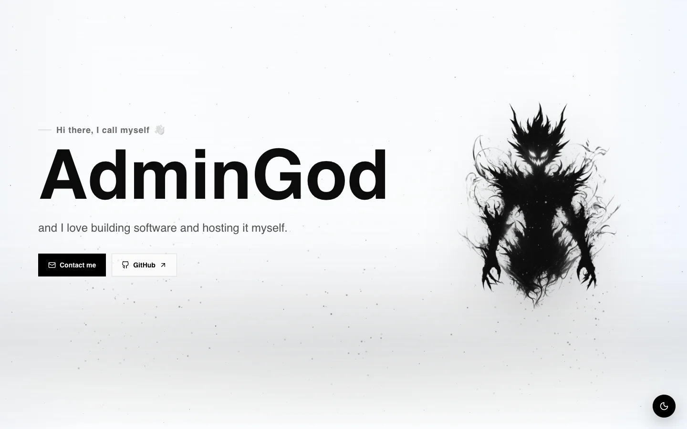
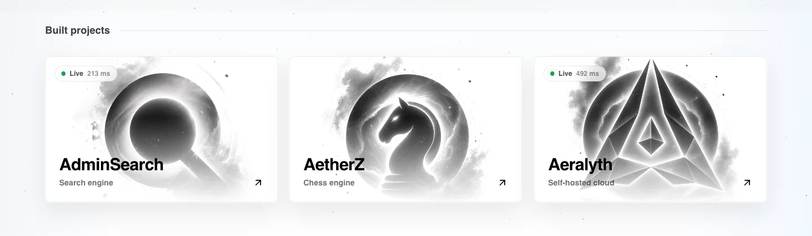
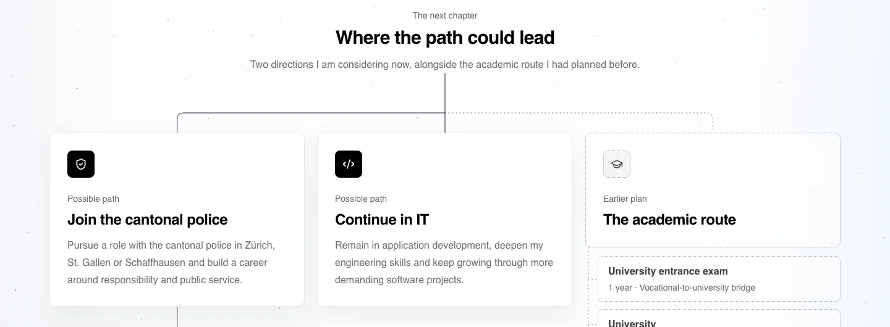
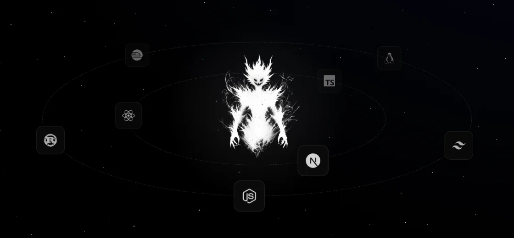
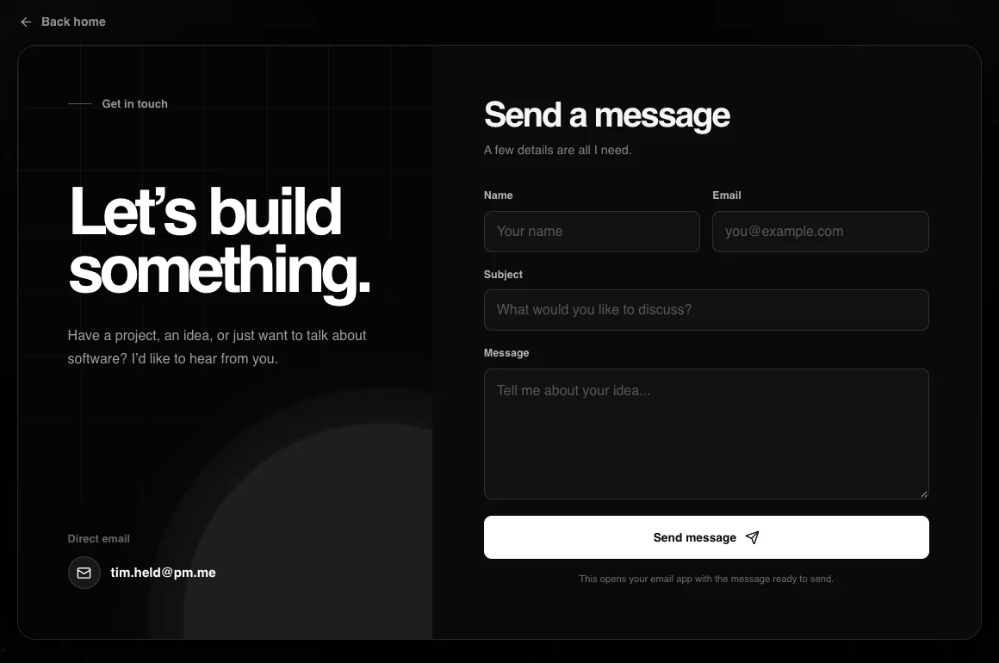

# AdminGod

**I love building software and hosting it myself.**

**[admingod.ch](https://admingod.ch)**

 

  

### 🛠️ Built projects

A search engine, a chess engine and a self-hosted cloud. The ones I host show whether they're live.

  

### 🧭 Career roadmap

From school in Germany to an apprenticeship in Switzerland, and the paths I'm considering next.

  

### 🪐 Tools I work with

Next.js, React, TypeScript, Tailwind CSS, Node.js, Rust, Railway and Linux.

  

### ✉️ Get in touch

  

Built and self-hosted by <a href="https://github.com/AdminGodZ">AdminGod</a>

