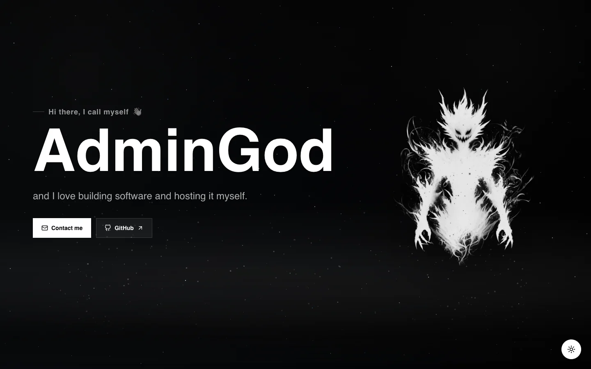

<div align="center">

# AdminGod

**My personal portfolio: the software I build, the tools I use, and where I'm headed next.**

[](https://github.com/AdminGodZ/admingod/actions/workflows/ci.yml)
[](https://astro.build)
[](https://react.dev)
[](https://www.typescriptlang.org)
[](https://tailwindcss.com)
[](https://railway.com)

**[admingod.ch](https://admingod.ch)**

<br />

<picture>
  <source media="(prefers-color-scheme: dark)" srcset="docs/hero-dark.webp" />
  <source media="(prefers-color-scheme: light)" srcset="docs/hero-light.webp" />
  
</picture>

</div>

<br />

## ✨ Highlights

|                             |                                                                                                                          |
| --------------------------- | ------------------------------------------------------------------------------------------------------------------------ |
| 🌌 **Living background**    | A starfield behind every page and a canvas particle field rising out of the hero.                                        |
| 🟢 **Live status pills**    | Project cards for self-hosted services ping them from the browser and show whether they're up, with the round-trip time. |
| 🧭 **Career roadmap**       | A scroll-driven timeline from school to apprenticeship that branches into the paths I'm considering next.                |
| 🪐 **Orbiting stack**       | The tools I work with circle the logo on two tilted rings, passing behind it as they go around.                          |
| 🌗 **Light & dark themes**  | The new theme spreads out from the toggle as a growing circle, using the View Transitions API.                           |
| ⚡ **Fully static**         | Astro renders every page at build time and only the interactive pieces ship as React islands.                            |
| ♿ **Reduced motion aware** | Scroll reveals, the starfield and the particle effects settle down when `prefers-reduced-motion` is set.                 |

<div align="center">
<br />

<br /><br />

<br /><br />

<br /><br />
</div>

## 🚀 Getting started

You need Node.js 26 (see [`.nvmrc`](.nvmrc)).

```bash
npm install
npm run dev
```

Open [http://localhost:4321](http://localhost:4321).

| Command             | What it does                                       |
| ------------------- | -------------------------------------------------- |
| `npm run dev`       | Starts the dev server with hot reload              |
| `npm run build`     | Typechecks, then builds the static site to `dist/` |
| `npm run preview`   | Serves the production build locally                |
| `npm run typecheck` | Runs `tsc --noEmit`                                |
| `npm run lint`      | Lints and checks formatting with Biome             |
| `npm run format`    | Formats the code with Biome                        |

## 🧭 Project structure

```text
src/
├── pages/
│   ├── index.astro            # Hero, projects, roadmap, tool stack, footer
│   ├── contact.astro          # Contact form that opens a prefilled email
│   ├── 404.astro
│   └── sitemap.xml.ts
├── layouts/layout.astro       # Metadata, pre-paint theme script, theme toggle
├── components/
│   ├── portfolio/
│   │   ├── hero-text-reveal.tsx      # Animated hero heading and actions
│   │   ├── void-particle-field.tsx   # Canvas particles rising out of the hero
│   │   ├── living-starfield.astro    # Page-wide starfield
│   │   ├── service-status.astro      # Live reachability pill for self-hosted projects
│   │   ├── career-roadmap.astro      # Timeline markup and styles
│   │   ├── career-roadmap-motion.ts  # Scroll-driven roadmap animation
│   │   ├── stack-orbit.astro         # Tools orbiting the logo
│   │   ├── scroll-reveal.astro       # Fades sections in as they enter the viewport
│   │   └── scroll-sidebar.tsx        # Draggable scroll position indicator
│   └── ui/button.tsx
├── assets/                    # Logo and project artwork, optimized by astro:assets
└── styles/global.css          # Tailwind v4 theme tokens
public/                        # Favicons, robots.txt, white logo for dark mode
scripts/smoke-test.sh          # Checks a running container
```

## 🚢 CI/CD

[`.github/workflows/ci.yml`](.github/workflows/ci.yml) runs on every pull request and every push to `master`:

| Job                    | Checks                                                                                                                   |
| ---------------------- | ------------------------------------------------------------------------------------------------------------------------ |
| 🧹 Biome               | `biome ci`: lint, formatting, import order                                                                               |
| 🔨 Typecheck and build | `tsc --noEmit`, `astro build`, expected pages exist, lockfile in sync                                                    |
| 🛡️ Dependency audit    | `npm audit` fails on high or critical advisories in production dependencies                                              |
| 🐳 Container           | builds the `Dockerfile` and runs `scripts/smoke-test.sh` against it: routes, 404s, sitemap, caching and security headers |

On `master`, the **Deploy to Railway** job runs only after all four pass, and deploys with `railway up`.

> [!NOTE]
> Deploying needs the `production` GitHub environment to have a `RAILWAY_TOKEN` secret (a Railway project token for the
> production environment) and a `RAILWAY_SERVICE` variable (`admingod`).

## 🐳 Running the container

The site ships as a [Caddy](https://caddyserver.com) container ([`Dockerfile`](Dockerfile), [`Caddyfile`](Caddyfile),
[`railway.json`](railway.json)). Caddy serves the static build with compression, long-lived caching for hashed assets
and security headers. To check it locally:

```bash
docker build -t admingod .
docker run --rm -e PORT=8080 -p 8080:8080 admingod
scripts/smoke-test.sh http://localhost:8080
```

<div align="center">
<br />


<sub>Built and self-hosted by <a href="https://github.com/AdminGodZ">AdminGod</a></sub>

</div>
